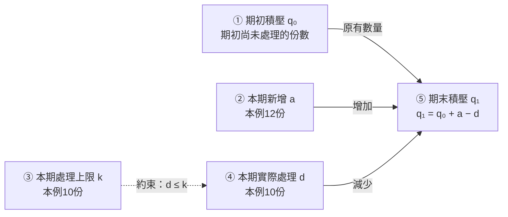
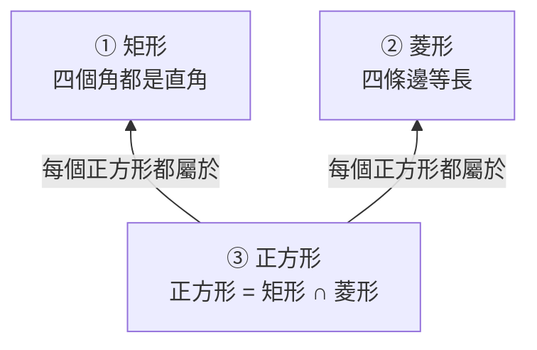

# 表達樣例：同一副洞察視角，不同的知識形狀

以下兩個虛構教學片段示範如何讓結構隨關係變化。示例只校準表達尺度，不提供需要套用的佈局、題材或節點清單。

## 例一：申請積壓是一組存量與流量關係

**輸入材料**：某視窗這一小時收到 12 份申請，實際處理了 10 份；按當前流程，每小時最多能處理 10 份。已有積壓與本小時新增要分開看。若新增持續超過處理能力，積壓就會增加。提高處理能力可能有幫助，但還要檢查實際處理量及質量。

**看出的結構**：新增和處理改變積壓，處理能力約束實際處理量。圖圍繞數量關係展開，例項直接標在對應變數旁邊。

同一時段、同一類申請，數量都以「份」計。本例忽略撤回、轉交等其他進出；實際存在時，要補進賬目。

### ① 期初積壓：時段開始時已經等著的申請

\[
q_0:=\text{期初已進入但尚未處理的申請份數}
\]

這是存量。材料沒有給出具體數字，就保留未知；不能把每小時新來的 12 份當作已有積壓。

### ② 本期新增：這一時段新進入的申請

\[
a:=\text{本時段進入的申請份數}=12
\]

它使待處理總量增加。12 是這一小時的記錄，不說明以後每小時都固定為 12。

### ③ 本期處理上限：當前條件下最多能處理的數量

\[
k:=\text{本時段在當前流程下最多能處理的份數}=10
\]

它給實際處理量設定上限：\(d\leq k\)。上限為 10 不保證實際一定處理了 10；能力與產出是兩個概念。

### ④ 本期實際處理：這一時段確實完成的申請

\[
d:=\text{本時段實際完成處理的份數}=10
\]

這是記錄中的實際產出。提高 \(k\) 後是否真的提高 \(d\)，需要新的記錄，不能靠更高的能力目標代替觀察。

### ⑤ 期末積壓：原有數量加上淨增減

\[
q_1:=\text{期末尚未處理的份數}=q_0+a-d
\]

代入本例：\(q_1=q_0+2\)。當前積壓具體多少仍未知，但這一小時增加 2 份可由記錄算出。

這條式子還給出判別依據：在上述統計邊界內，\(q_1>q_0\iff a>d\)。同樣叫「積壓嚴重」，可能是已有數量大，也可能是仍在持續淨流入；觀察量不同，後續判斷也不同。

若要檢查調整是否有效，可以另看「積壓按約定減少且質量達標」。具體閾值與檢查時段原文未給出，這項補充檢驗不必變成主圖的統一終點。

## 例二：矩形與菱形是一組交叉分類關係

**輸入材料**：矩形要求四個角都是直角，菱形要求四條邊等長；正方形同時滿足這兩組條件。因此一個圖形可以同時是矩形和菱形，兩個名稱並不排斥。

**看出的結構**：兩個判據相交，交集形成正方形。這裡適合畫集合關係，無須新增「應用—驗證—反饋」流程。

本例討論通常的非退化簡單平面四邊形。箭頭標的是包含關係，不是生成順序或因果。

| 節點 | 定義與公式 | 具體語義 |
|---|---|---|
| ① 矩形 | `矩形 := {四邊形：四個角都是直角}` | 一張相鄰邊長為 2、3 的長方形紙片滿足此條件；判別看角，而不看圖形是否橫著擺。紙片是補充設例。 |
| ② 菱形 | `菱形 := {四邊形：四條邊等長}` | 相鄰角為 60°、120° 的菱形屬於這一類，卻不是矩形；該圖形是補充的邊界例子。 |
| ③ 正方形 | `正方形 := 矩形 ∩ 菱形` | 交集要求兩組條件同時滿足。正方形能同時歸入兩個類別，分類無需互斥。 |

把某個物件判為正方形後，可以沿兩條包含關係推出它屬於矩形、也屬於菱形；僅知道它是矩形，不能反向推出正方形。具體物件與判別依據都在圖中起作用，但不必被單獨排成三個層次。

## 表達尺度

- `效率 = 能力 × 努力 × 流程` 若沒有量的定義、單位或依據，只增加了公式外觀。
- 每篇文章都畫「經驗 → 抽象 → 概念 → 學會」，會用分析框架遮住材料自身的知識。
- 只把「具象層／概念層／應用層」換成同義標題，仍然沒有解除固定佈局。真正改變的是圖由什麼關係組織。

合格的地圖讓原文自己的物件站在圖裡，連線表達它們實際具有的關係，定義和例子讓這些關係可以理解與檢驗。
